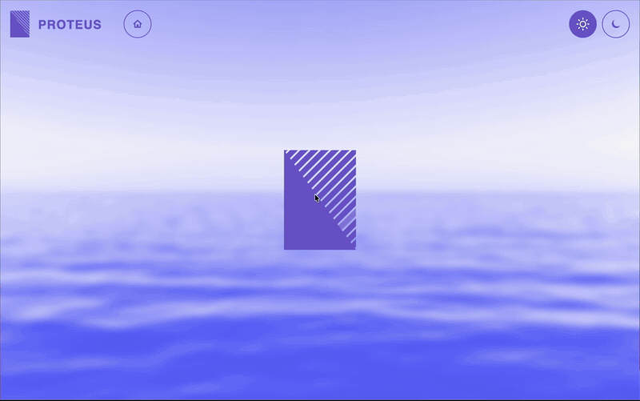

  <picture>
    <source media="(prefers-color-scheme: dark)" srcset="https://raw.githubusercontent.com/ichellin1/proteus/main/brand/logo/assets/lockup-color-dark.png">
    
  </picture>

Proteus is a rendering framework designed around a new UX paradigm: **UI components are metamorphic.** They do not navigate to new screens or swap out for different components — they *transform* into them. A button can become a list. A list can collapse back into a button. A list item can become a video player. The component does not disappear; it *shapeshifts*, and the transition between one form and another is a first-class, visually continuous experience.

Performance-minded, it draws with the GPU and significantly outperforms CSS transitions in benchmark testing on both Chrome and Safari. Proteus runs both natively in Mac, Windows and Linux OSs and in browsers that support WebGL2. Apps are written in Rust or TypeScript. The TypeScript SDK is a thin layer over the Rust API, and the API is designed so other languages can be added the same way.

  

## Get started

- [Getting started in Rust](./docs/getting-started/rust.md): create a project, write a first
  app, and run it in a desktop window and in a browser.
- [Getting started in TypeScript](./docs/getting-started/typescript.md): install the SDK from
  npm, set up Vite, and run the app in a browser.

## Learn more

- [Guides](./docs/README.md): getting started, the concepts, and how-tos, in Rust and
  TypeScript.
- API reference: [Rust](https://ichellin1.github.io/proteus/api/rust/proteus_sdk/) and
  [TypeScript](https://ichellin1.github.io/proteus/api/ts/).
- [Examples](./examples/README.md): a photo gallery, a menu, an onboarding flow and video, in
  both languages.
- [The reference demo](https://ichellin1.github.io/proteus/), running in your browser.
- [Architecture](./ARCHITECTURE.md): how Proteus is built, and why.
- [Benchmarks](./BENCHMARKS.md): how fast it draws, against CSS, Canvas 2D and hand-written
  WebGL2.
- [Vision](./VISION.md) and [roadmap](./ROADMAP.md): where Proteus is going.
- [Contributing](./CONTRIBUTING.md): building from source, and how code and docs are written.

## Status

Proteus is at 0.1, an early release: its API may change from one 0.x version to the next. Video
is experimental. [ARCHITECTURE.md](./ARCHITECTURE.md#known-limits) lists the known limits,
each planned to be addressed in a future release.

CI builds Proteus and runs its tests, GPU tests included, on macOS, Linux and Windows. It has
been run by hand on macOS, natively and in a browser.

## License

Licensed under either of [MIT](./LICENSE-MIT) or [Apache 2.0](./LICENSE-APACHE), at your option.
